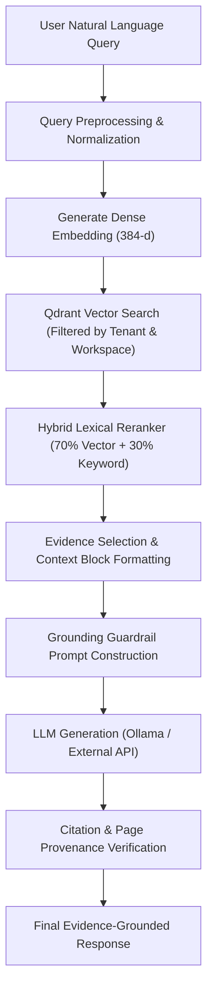
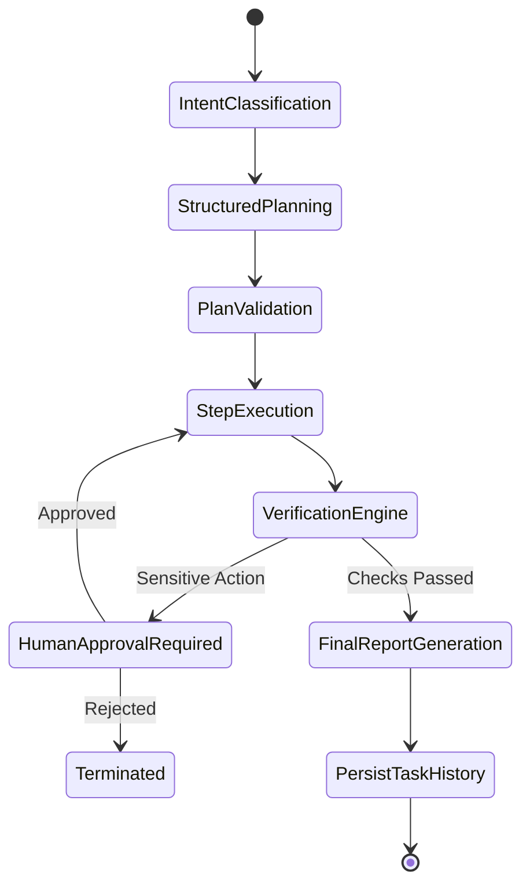

# DocuMind AI — AI Architecture & LangGraph Agent Specification

## 1. Grounded RAG Architecture

DocuMind AI enforces an evidence-bounded retrieval pipeline to guarantee verifiable outputs and eliminate hallucinations.

---

## 2. DocuMind Intelligence Agent (LangGraph Workflow)

The agent operates as a stateful, bounded state machine with explicit transitions, execution budgets, checkpointing, and human approval gates.

---

## 3. Tool Registry Specifications

The agent orchestrates 22 approved tools registered with explicit parameter schemas:

1. `search_documents`: Discovers documents in workspace matching title or topic.
2. `semantic_search`: Dense vector search across indexed embeddings.
3. `hybrid_search`: Hybrid dense vector search + keyword reranking.
4. `retrieve_document_chunks`: Retrieves ordered text chunks for a document.
5. `read_document_page`: Reads the full text of an exact page.
6. `extract_document_metadata`: Inspects page count, chunk count, file size.
7. `summarize_document`: Produces executive, detailed, or section-wise summaries.
8. `compare_documents`: Compares multiple documents side by side.
9. `extract_entities`: Identifies organizations, metrics, and domain entities.
10. `extract_tables`: Parses tabular structures and cell values from pages.
11. `analyze_research_paper`: Deconstructs paper objectives, datasets, and limitations.
12. `extract_methodology`: Isolates algorithms, techniques, and system workflows.
13. `extract_findings`: Extracts empirical results with page provenance.
14. `identify_research_gaps`: Discovers unaddressed limitations and open questions.
15. `detect_contradictions`: Identifies conflicting assertions between papers.
16. `calculate_statistics`: Deterministic Python arithmetic (mean, median, variance, sum) preventing LLM math errors.
17. `analyze_dataset`: Computes column data types, distributions, and summary stats.
18. `generate_quiz`: Generates grounded MCQs and short-answer study questions.
19. `generate_flashcards`: Creates active recall study flashcard decks.
20. `generate_report`: Formulates structured evidence-grounded Markdown reports.
21. `verify_citations`: Verifies that cited page numbers exist in the source document.
22. `verify_evidence`: Confirms assertions match retrieved passage text.

---

## 4. Multi-Provider LLM Abstraction

DocuMind AI decouples business logic from specific AI vendors via `LLMService`:
- **Ollama**: Default local offline provider (`http://localhost:11434`, model: `llama3.2`).
- **OpenAI**: Configurable for `gpt-4o` and `gpt-4o-mini`.
- **Google Gemini**: Configurable for `gemini-1.5-flash` and `gemini-1.5-pro`.
- **Anthropic**: Configurable for `claude-3-5-sonnet`.
- **Groq**: Configurable for high-throughput Llama inference.
- **Deterministic Rule Grounding Fallback**: Used in automated test suites and offline environments when external APIs or local LLM daemons are unreachable, ensuring continuous zero-crash operation.
