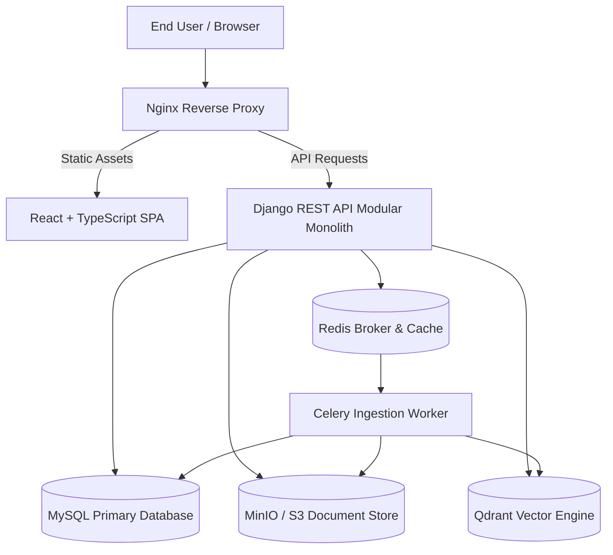
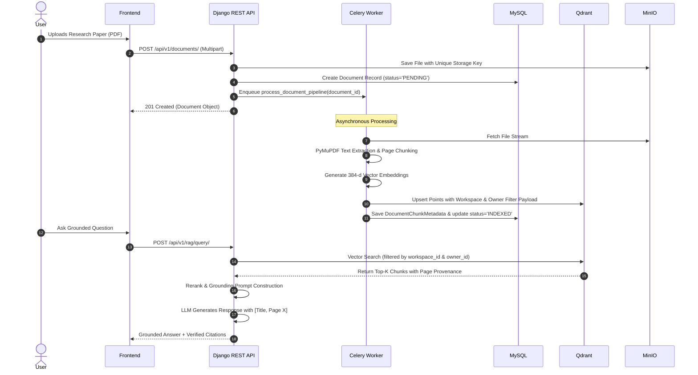

# DocuMind AI — System Architecture Specification

## 1. Architectural Philosophy

DocuMind AI is engineered as a **Modular Monolith** backend paired with a high-performance single-page application frontend. This design guarantees clean separation of concerns, high maintainability, robust transactional consistency in MySQL, and low operational complexity without premature microservice fragmentation.

---

## 2. Component Specifications

### 2.1 Frontend Architecture
- **Framework**: React 18 with TypeScript and Vite.
- **Styling**: Tailwind CSS utilizing a custom dark SaaS design system with slate and brand teal accents.
- **State Management**:
  - `Zustand`: Global state stores (`authStore`, `workspaceStore`) for lightweight, decoupled reactive state.
  - `TanStack Query`: Server state caching, background refetching, and query invalidation.
- **Routing**: `React Router v6` with protected route layouts (`AppLayout` vs `AuthLayout`).

### 2.2 Backend Architecture
- **Framework**: Python 3.11+ / Django 5.0 with Django REST Framework (DRF).
- **Authentication**: JWT-based authentication using `rest_framework_simplejwt` with automatic token rotation and blacklist enforcement.
- **Tenant Isolation**: Every incoming request extracts the authenticated user from the token. Workspace membership is validated at the database layer before allowing query access or mutations.

### 2.3 Storage & Ingestion Pipeline
1. **Multipart Upload**: Document is validated for MIME type, extension (`.pdf`, `.docx`, `.txt`), and file size (`MAX_UPLOAD_SIZE_MB`).
2. **Object Storage**: Stored in MinIO S3 bucket or local media cache under a deterministic UUID storage key.
3. **Asynchronous Processing**: `process_document_pipeline` Celery task extracts text page-by-page using `PyMuPDF`.
4. **Chunking**: `DocumentChunker` splits text preserving exact page numbers, character start/end offsets, and chunk indices.
5. **Vector Indexing**: Chunks are embedded via `SentenceTransformers` (`all-MiniLM-L6-v2`) and upserted to Qdrant with tenant-filtered payload metadata.
6. **Relational Synchronization**: `DocumentChunkMetadata` records are stored in MySQL to allow fast relational querying of document structure.

---

## 3. Data Flow Diagram

