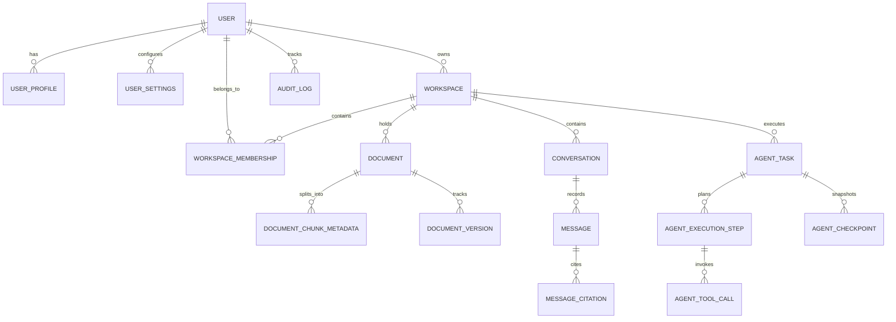

# DocuMind AI — MySQL Database Schema Specification

The primary database utilizes MySQL 8.0 with InnoDB engine, utf8mb4 charset, strict SQL modes, and UUID primary keys to ensure multi-tenant reliability and global uniqueness.

---

## 1. Core Tables & Column Definitions

### `accounts_user`
| Column | Type | Constraints | Description |
|---|---|---|---|
| `id` | CHAR(36) | PRIMARY KEY | Unique User UUID |
| `email` | VARCHAR(255) | UNIQUE, NOT NULL, INDEX | Primary login identifier |
| `password` | VARCHAR(255) | NOT NULL | PBKDF2/Argon2 password hash |
| `first_name` | VARCHAR(150) | NULL | User first name |
| `last_name` | VARCHAR(150) | NULL | User last name |
| `is_active` | BOOLEAN | DEFAULT TRUE | Account state |
| `is_staff` | BOOLEAN | DEFAULT FALSE | Staff administration access |
| `created_at` | DATETIME(6) | NOT NULL | Account creation timestamp |

### `workspaces_workspace`
| Column | Type | Constraints | Description |
|---|---|---|---|
| `id` | CHAR(36) | PRIMARY KEY | Unique Workspace UUID |
| `owner_id` | CHAR(36) | FK -> accounts_user(id) | Tenant owner |
| `name` | VARCHAR(150) | NOT NULL | Workspace title |
| `slug` | VARCHAR(180) | NOT NULL | URL-safe slug |
| `is_default` | BOOLEAN | DEFAULT FALSE | Default workspace flag |
| `settings` | JSON | NOT NULL | Workspace-specific configs |

### `documents_document`
| Column | Type | Constraints | Description |
|---|---|---|---|
| `id` | CHAR(36) | PRIMARY KEY | Unique Document UUID |
| `workspace_id` | CHAR(36) | FK -> workspaces_workspace(id) | Workspace container |
| `owner_id` | CHAR(36) | FK -> accounts_user(id) | Document uploader |
| `title` | VARCHAR(255) | NOT NULL | Document title |
| `file_name` | VARCHAR(255) | NOT NULL | Original upload filename |
| `file_size` | BIGINT | NOT NULL | File size in bytes |
| `storage_key` | VARCHAR(512) | NOT NULL | MinIO / S3 object key |
| `status` | VARCHAR(30) | INDEX | PENDING, PROCESSING, INDEXED, FAILED |
| `page_count` | INT | DEFAULT 0 | Extracted page count |
| `chunk_count` | INT | DEFAULT 0 | Indexed vector chunks |
| `processing_time_ms`| INT | DEFAULT 0 | Ingestion duration in ms |

### `documents_documentchunkmetadata`
| Column | Type | Constraints | Description |
|---|---|---|---|
| `id` | CHAR(36) | PRIMARY KEY | Chunk record UUID |
| `document_id` | CHAR(36) | FK -> documents_document(id) | Parent document |
| `chunk_index` | INT | NOT NULL, INDEX | Sequential chunk position |
| `page_number` | INT | NOT NULL, INDEX | Exact source page number |
| `qdrant_point_id` | VARCHAR(128) | NOT NULL, INDEX | Correlating Qdrant vector ID |
| `chunk_text_preview` | VARCHAR(500) | NOT NULL | Searchable excerpt |

### `agent_agenttask`
| Column | Type | Constraints | Description |
|---|---|---|---|
| `id` | CHAR(36) | PRIMARY KEY | Unique Task UUID |
| `workspace_id` | CHAR(36) | FK -> workspaces_workspace(id) | Tenant workspace |
| `user_id` | CHAR(36) | FK -> accounts_user(id) | Initiating user |
| `task_description` | TEXT | NOT NULL | Natural language goal |
| `intent` | VARCHAR(150) | NOT NULL | Classified task intent |
| `status` | VARCHAR(30) | INDEX | PLANNING, EXECUTING, COMPLETED, etc. |
| `execution_plan` | JSON | NOT NULL | Array of structured steps |
| `final_report` | LONGTEXT | NULL | Synthesized Markdown output |
| `findings` | JSON | NULL | Bulleted evidence findings |
| `evidence` | JSON | NULL | Intermediate tool outputs |

---

## 2. Vector Store Schema (Qdrant)

Vector embeddings are stored exclusively inside Qdrant and correlated with MySQL via `qdrant_point_id`:
- **Collection**: `documind_collection`
- **Vector Dimension**: 384 (`all-MiniLM-L6-v2`)
- **Distance Metric**: Cosine Similarity
- **Payload Indexing Fields**:
  - `workspace_id` (Keyword index for strict tenant filtering)
  - `owner_id` (Keyword index)
  - `document_id` (Keyword index)
  - `page_number` (Integer index)
  - `text` (Payload storage for zero-roundtrip evidence retrieval)
