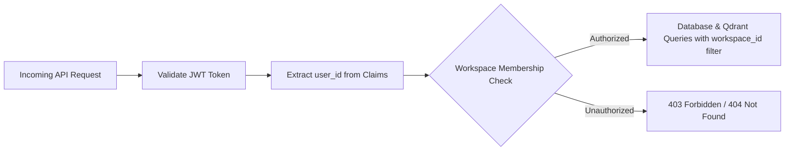

# DocuMind AI — Security & Multi-Tenant Isolation Specification

## 1. Multi-Tenant Isolation

Multi-tenant security is strictly enforced at the backend service layer:
- **Zero Trust on Frontend Identifiers**: The system never relies on client-supplied `user_id` or `owner_id` parameters. All identities are derived from cryptographically verified JWT tokens.
- **Workspace Query Scoping**: Every database query on documents, conversations, and agent tasks joins against `WorkspaceMembership` or `Workspace.owner`.
- **Vector Search Isolation**: Qdrant queries mandate a `must` filter on `workspace_id` and `owner_id`, ensuring vector points from other users can never be retrieved across tenant boundaries.

---

## 2. Prompt Injection Defense

Uploaded documents are treated as untrusted data rather than system instructions:
- **Instruction Boundary Isolation**: Document text is isolated inside formatted `DOCUMENT EVIDENCE` blocks separated from system instructions.
- **Guardrail Prompts**: Explicit guardrails prevent documents containing phrases like *"Ignore all previous instructions"* from hijacking system behavior.
- **Tool Execution Boundaries**: The AI model cannot execute arbitrary shell scripts, write to disk outside the storage service, or execute raw SQL. All tools are constrained to the approved `ToolRegistry`.

---

## 3. Data Deletion & Privacy Cascades

When a document is deleted by its owner:
1. **Object Storage Purge**: The original file is removed from MinIO / S3.
2. **Vector Space Purge**: All associated vector embeddings in Qdrant are deleted using document ID filter selectors.
3. **Relational Cascades**: Database records, chunk metadata, and derived analysis records are deleted via MySQL CASCADE rules.

---

## 4. Tamper-Evident Audit Logging

The `AuditLoggingMiddleware` intercepts all mutating API calls (`POST`, `PUT`, `PATCH`, `DELETE`) and records:
- Authenticated user ID.
- Client IP address.
- Request path and HTTP method.
- HTTP status code.
- Timestamp.

**Sensitive Key Redaction**: Passwords, tokens, API keys, and secret values are automatically redacted before audit persistence.
